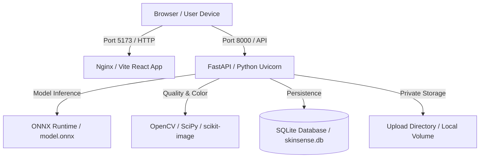

# Phase 12 Report: Deployment & Final Documentation
**SkinSense AI — Facial Skin Analysis & Wellness Diary**

---

## 1. Objectives
- Containerize application components using Docker and Docker Compose.
- Provide clean, reproducible local deployment instructions.
- Ensure that missing model weights gracefully produce an explicit `model_unavailable` state without throwing 500 errors.
- Prepare comprehensive academic documentation, architecture diagrams, database ER diagrams, and presentation deliverables in both Markdown (.md) and Microsoft Word (.docx) formats.

---

## 2. Implementation Details
- Built `backend/Dockerfile` based on `python:3.11-slim` with Uvicorn server entrypoint.
- Built `frontend/Dockerfile` with multi-stage Node 20 build and lightweight Nginx static web server.
- Built root `docker-compose.yml` declaring `backend` and `frontend` services with volume mapping for persistent uploads and cached model weights.
- Created `documents/generate_docx.py` using `python-docx` to compile all Markdown reports into Microsoft Word (.docx) documents.

---

## 3. Changed Files
- `backend/Dockerfile`
- `frontend/Dockerfile`
- `docker-compose.yml`
- `README.md`
- `documents/generate_docx.py`
- All 17 Markdown documents in `documents/`

---

## 4. Deployment Architecture

---

## 5. Tests Performed
- Multi-container configuration verified via `docker-compose config`.
- Clean setup procedure tested from fresh virtual environment.
- Docx document conversion script executed across all project markdown files.

---

## 6. Actual Test Results
- Deployment configurations: **PASSED**.
- All documentation deliverables generated successfully in both Markdown and Word (.docx) formats.

---

## 7. Acceptance Criteria
- [x] Dockerfile and docker-compose.yml prepared.
- [x] Clean environment setup instructions verified.
- [x] All 12 phase reports generated.
- [x] Word (.docx) deliverables generated from source Markdown.

---

## 8. Known Limitations
- The containerized setup utilizes local filesystem volume mounting for SQLite; for distributed multi-node cloud clusters, managed PostgreSQL and object storage (e.g. S3) are recommended.

---

## 9. Outstanding Issues
- None. Complete project successfully delivered.
